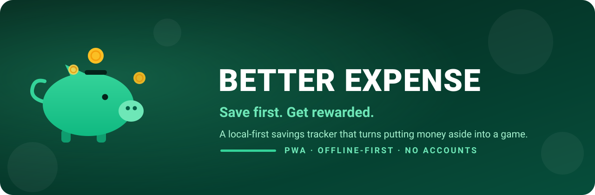
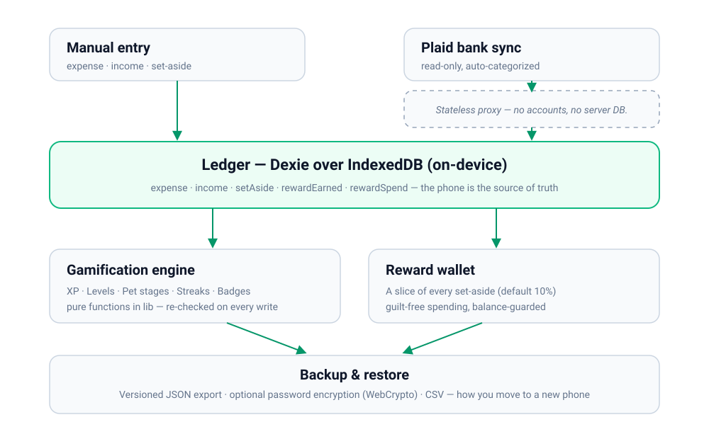
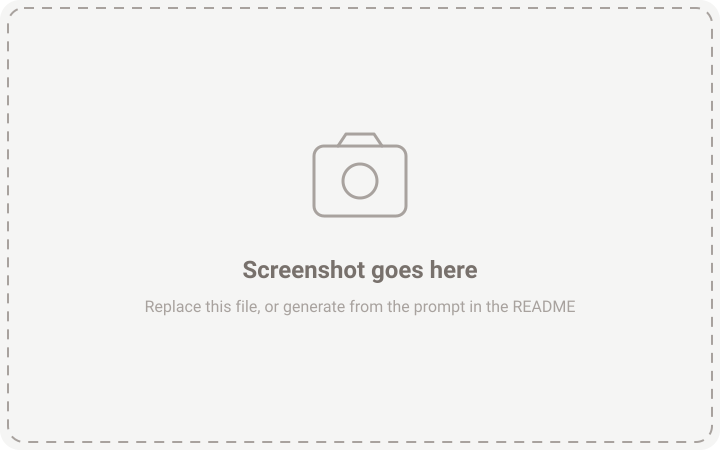

<p align="center">
  
</p>

# Better Expense

<p align="center">
  <b>Save first. Get rewarded.</b>
</p>
<p align="center">
A web app that makes saving a game you want to play. XP, levels, a virtual pet, streaks, badges and a guilt-free reward wallet without your data ever leaving your phone.
</p>

<div align="center">

  
  
  
  

</div>

<br>

##  The Problem

Budgeting apps have always been the source of my cortisol spikes. Red negative numbers, Over-budget reminders, your spending has increased notifications; they use guilt as a tool rather than actually motivating you.

<table width="100%">
  <tr>
    <td width="33%" valign="top">
      <h3 align="center"> Tracking feels like homework</h3>
      <p align="center">Logging every small expense by hand feels way too much like a chore, making it nearly impossible to commit.</p>
    </td>
    <td width="33%" valign="top">
      <h3 align="center"> Budgets shame you</h3>
      <p align="center">Nothing in the experience of tracking your expenses makes the act of saving feel good on its own.<br></p>
    </td>
    <td width="33%" valign="top">
      <h3 align="center"> Your data isn't yours</h3>
      <p align="center">Most finance apps ship your transaction history to a server, bundle ads, and paywall your own export.<br><br></p>
    </td>
  </tr>
</table>

<br>

##  The Solution

Better Expense reframes **paying yourself first** as the one action the app rewards. It's a **local-first PWA**: your ledger lives in the browser's IndexedDB, never on a server. Set money aside, earn XP, grow a pet, and unlock a slice you get to spend guilt-free.

### How it works

<p align="center">
  
</p>

1. **Log**: Record expenses and income in a tap. Enter them manually, or pull them in automatically from your bank via Plaid.
2. **Set aside**: Move money into a savings goal. This is the action the whole app is built to reward.
3. **Earn XP**: Every set-aside pays out: 5 base, +1 per dollar (capped), 100 for finishing a goal, and 5/day for showing up.
4. **Level up & evolve**: XP levels you up and grows your pet: 🥚 Egg → 🐷 Piglet → 🐽 Squealer → 🐖 Chonk → 🏅 Royal Pig.
5. **Build streaks**: Daily check-ins and "no-treat" days compound into badges and a record worth protecting.
6. **Spend guilt-free**: A slice of every set-aside (default 10%) lands in a reward wallet you can spend without an ounce of guilt.

### Game mechanics

| Mechanic | How it works |
| :--- | :--- |
| **XP** | 5 per daily check-in · 5 base + 1 per dollar set aside, capped at 50 per save · 100 for completing a goal. |
| **Levels** | Derived from lifetime XP. Each level costs `40 + (level − 1) × 55` XP to clear. |
| **The pet** | Grows with lifetime XP across five stages: Egg, Piglet, Squealer, Chonk, Royal Pig. |
| **Streaks** | A login streak for daily check-ins, and a no-spend streak for treat-free days. |
| **Badges** | First save · $100 & $1,000 saved · 3 & 7 no-treat days · first goal crushed · 10 expenses logged · level 5. |
| **Reward wallet** | A percentage of each set-aside becomes spendable guilt-free cash, balance-guarded, so you can never spend more than you actually set aside. |

<br>

##  Tech Stack

Built to stay small, work offline, and keep every byte on your device.

| **Component**  | **Technology**                                                                                                                                                                                                | **Description**                                                                                                                     |
| :------------- | :------------------------------------------------------------------------------------------------------------------------------------------------------------------------------------------------------------ | :---------------------------------------------------------------------------------------------------------------------------------- |
| **Frontend**   |                                                                                                                          | Next.js 16 App Router + React 19, TypeScript, Tailwind v4. Mobile-first.                                                            |
| **Local data** |                                                                                                        | Dexie 4 over IndexedDB. The phone **is** the database.                                                                              |
| **Bank sync**  |                                                                                                              | Optional read-only Plaid sync through stateless Next.js API routes. No accounts, no server-side storage, deduped by transaction id. |
| **Backups**    |                                                                                                         | Versioned JSON export/import, optional password encryption, plus CSV giving you the ability to transfer data to a new phone.        |
| **Tooling**    |   | `fake-indexeddb` + `tsx` smoke tests for the data, game, and backup layers; `sharp` for PWA icon generation.                        |

<br>

##  Visuals


|                          Dashboard                           |                          Add entry                           |
| :----------------------------------------------------------: | :----------------------------------------------------------: |
|   |  |
|                          **Goals**                           |                         **Rewards**                          |
|  |  |
|                          **Badges**                          |                         **Activity**                         |
|  |  |

<br>

## Getting started

Runs on Node 18+ and any modern browser. The whole app is client-side.

```bash
npm install
npm run dev          # http://localhost:3000
```

Bank sync is **optional**. To enable it, grab free sandbox keys from the
[Plaid dashboard](https://dashboard.plaid.com/), copy `.env.example` to
`.env.local`, and fill in:

```
PLAID_CLIENT_ID=...
PLAID_SECRET=...
PLAID_ENV=sandbox
```

Smoke tests run in Node against an in-memory IndexedDB, no browser needed:

```bash
npm run smoke        # data layer + gamification + backup/restore
```

Data lives in the browser, so use **Settings → Export** to move it between devices.

<br>

##  Roadmap

- [x] **PWA shell:** Mobile-first installable app: Next.js 16, React 19, Tailwind v4, offline service worker
- [x] **Local data layer:** Dexie/IndexedDB schema plus manual expense, income, and set-aside entry screens
- [x] **Gamification engine:** XP, levels, pet stages, login & no-spend streaks, badges, and the reward wallet
- [x] **Goals:** Create, track progress, archive, and quick-save into a savings goal
- [x] **Bank sync:** Optional Plaid import through a stateless, account-free proxy
- [x] **Backup & restore:** Versioned JSON export/import with optional encryption, plus CSV
- [ ] **Charts & trends:** Spend-by-category and month-over-month visuals
- [ ] **Budgets & envelopes:** Per-category limits that feed the no-spend logic
- [ ] **Recurring & subscriptions:** Detect and schedule repeating transactions
- [ ] **Multi-currency:** Everything is USD today
- [ ] **Native shells:** Capacitor/Tauri wrappers with real push notifications
- [ ] **Shared budgets:** Multiple people, one ledger, locally reconciled

<br>

##  Acknowledgements

- **Dexie.js** and the IndexedDB family for making local-first a joy to build on
- **Plaid** for a generous sandbox and a clean read-only transactions API
- The **Next.js**, **React**, and **Tailwind CSS** teams for the tooling
- **Lucide** & **Simple Icons** for the iconography
- Every book that ever said *pay yourself first*

And the [](https://github.com/matiassingers/awesome-readme) project, whose format inspired this page.
<br>

<p align="center">
  <sub>Built to make saving feel like play. 🐷</sub>
</p>
